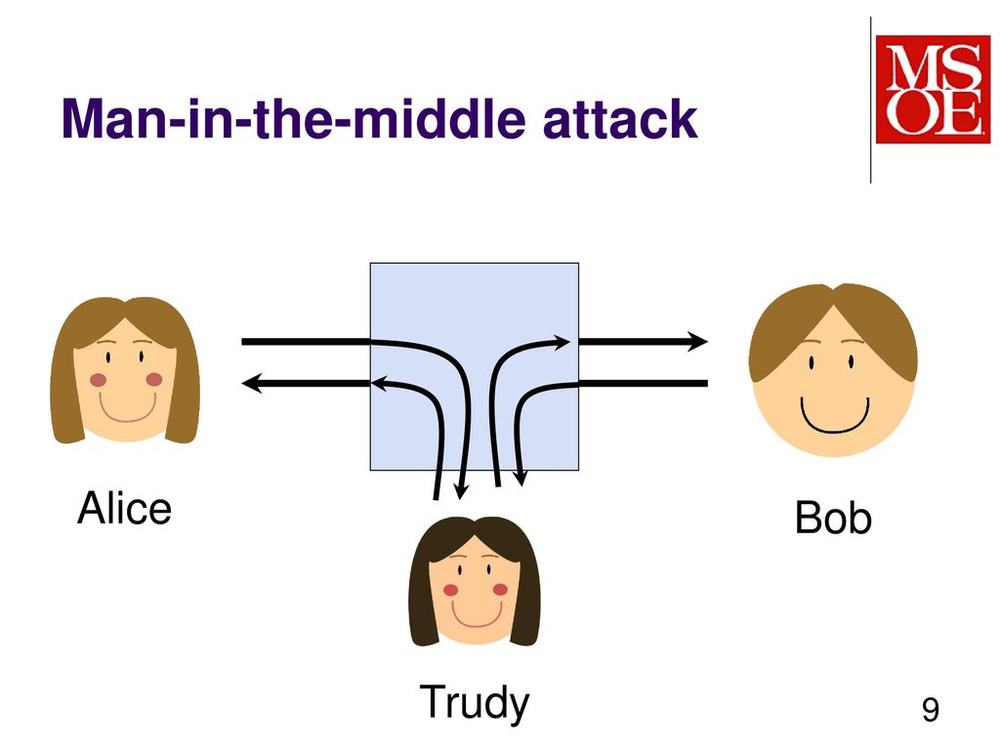

#### Criptarea

Să presupunem că Alice și Bob doresc să comunice pe Internet.
Pentru început, cei doi folosesc un canal simplu prin care transmit mesajele în clar.
Problema care apare este că Trudy, care este rău intenționat, poate asculta ce vorbesc Alice și Bob și va și înțelege mesajele deoarece ele sunt transmise în clar.

<figure>

</figure>

**Criptarea** înseamnă ascunderea datelor folosind un algoritm public și o cheie secretă.
În cazul nostru, Alice **criptează** mesajul pe care dorește să îl transmită, iar Bob îl **decriptează**.
Alice și Bob au aceeași cheie secretă negociată într-un moment de timp anterior comunicării.
**Trudy** vede în continuare mesajele, știe algoritmul de criptare (deoarece e public), dar nu cunoaște cheia de decriptare, deci nu poate vedea conținutul lor.
Un exemplu de algoritm de criptare este **AES**.

**Criptarea** presupune ascunderea/securizarea datelor într-o manieră recuperabilă.
Adică ele vor putea fi ulterior **decriptate**.

Folosind utilitarul **openssl** putem să criptăm conținutul unui fișier.

``` bash
student@uso:~$ echo -n "plaintext content" > plaintext_file.txt
student@uso:~$ openssl aes-256-cbc -in plaintext_file.txt -out encrypted_file.enc -pass pass:"uso rules"
student@uso:~$ ls
encrypted_file.enc  plaintext_file.txt
```

Utilizând parametrul **-d** putem decripta fișierul `encrypted_file.enc`.

``` bash
student@uso:~$ openssl aes-256-cbc -d -in encrypted_file.enc -out decrypted_file.txt -pass pass:"uso rules"
student@uso:~$ cat decrypted_file.txt
plaintext content
```
