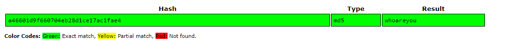
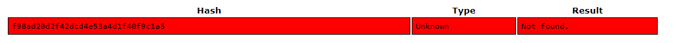
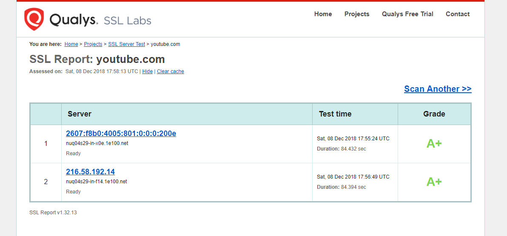
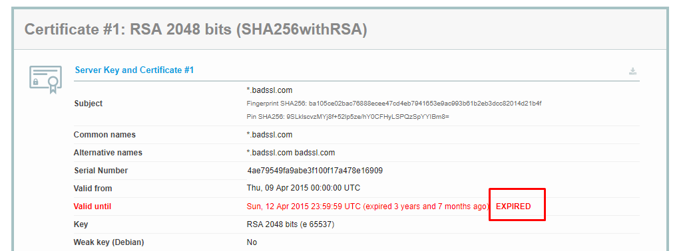

## Exerciții

### 1. Hash me

**[1a]** Realizați un md5 pe string-ul `whoareyou` folosind md5sum.

Hash-ul obținut trebuie să fie `a46601d9f660704eb28d1ce17ac1fae4`.
Asigurați-vă că obțineți același rezultat.

**[1b]** Intrați pe [CrackStation](https://crackstation.net/) și introduceți hash-ul vostru.
Veți observa că el a fost deja spart.

<figure>

</figure>

**[1c]** Generați un string de 10 caractere random ca în exemplul de mai jos:

``` bash
student@uso:~$ head /dev/urandom | tr -dc A-Za-z0-9 | head -c 10 ; echo ''
oargwZRgEv
```

**[1d]** Folosiți string-ul generat mai devreme ca **Salt** pentru mesajul `whoareyou`.
În cazul din exemplu, s-ar fi realizat md5-ul pe `oargwZRgEvwhoareyou`

**[1e]** Încercați pe [CrackStation](https://crackstation.net/) să spargeți acest nou md5.
Observați că un **Salt** întărește securitatea unui hash.

<figure>

</figure>

### 2. Generare de parole

Pe Linux, putem genera parole folosind utilitarul `pwgen`:

``` bash
student@uso:~$ pwgen
ceigie4E phie3fuG ooQua8ch Quochu7A Wi2iesha fiena3Qu xohWah7w nahte9Ao
Caem6Eis Jeiquo2f phahM1je oLou6ohb aishae2O bo1Eishu PhugeS1z Tang6oox
Gaif4aij xoh1Evoa Eipoax7A ADi5Hohx ahJ8aida Aef0och4 iuD7oa3y Tatoo8po
Aephuit2 Segh9gah usaif4Ah Oex5quoo Thei9kae aoyuPh0F iu2vi3Ph aipai3Ow
Oof4Tei9 Naing5Ru nee9geiN noosh7Fo aF7ae8va zoo0IT7w uoj2Sie8 Zooghee0
........
```

**[2a]** În modul default, **pwgen** generează parole ușor de memorat.
Generați o parolă greu de memorat, sigură.
`Hint: man pwgen`

**[2b]** Folosind pwgen, generați o parolă de **80 de caractere**, **singură pe linie**, **fără vocale**, cu **cel puțin o majusculă** și fără să conțină **numere**.
`Hint: man pwgen`

### 3. Site-uri considerate sigure

Putem folosi [ssllabs](https://www.ssllabs.com/ssltest/) pentru a verifica [certificatul](https://www.techopedia.com/definition/29743/website-security-certificate) unui site HTTPS.

Introduceți **Hostname-ul** `youtube.com` și observați ce notă primește:

<figure>

</figure>

Introduceți apoi **Hostname-ul** `expired.badssl.com` ce are certificatul expirat:

<figure>

</figure>

[ssllabs](https://www.ssllabs.com/ssltest/) este un bun utilitar pentru a verifica dacă un site este sigur sau nu.

---

Pentru exercițiile următoare, mergeți în directorul `/home/student/uso-lab/` și rulați comanda `git pull`.
Mergeți în directorul `/home/student/uso-lab/labs/08-security/support`.

### 4. Spargerea parolei prin brute-force

Tehnica de **brute-force** presupune încercarea oricăror combinații posibile de caractere în încercarea de a sparge o parolă.
În cazul nostru, vom lucra cu un **zip**.

Dacă parola este suficient de lungă (peste 10-12 caractere) atunci ea este considerată relativ sigură pentru un atac de acest tip întrucât va dura mult prea mult găsirea parolei corecte, chiar cu cele mai puternice CPU-uri din prezent.

Vom încerca să spargem parola arhivei zip `secret_brute_force.zip`.
Pentru a face acest lucru, vom instala utilitarul **fcrackzip**:

``` bash
student@uso:~$ sudo apt-get install fcrackzip
```

Știm faptul că arhiva are o parolă de maxim 4 caractere, deci este fezabil să rulăm un atac de tip brute-force:

``` bash
student@uso:~/.../labs/08-security/support$ fcrackzip -v -l 1-4 -u secret_brute_force.zip
found file 'flag.txt', (size cp/uc     34/    22, flags 1, chk 6543)


PASSWORD FOUND!!!!: pw == fd7
student@uso:~/.../labs/08-security/support$ unzip -P fd7 secret_brute_force.zip
Archive:  secret_brute_force.zip
 extracting: flag.txt
student@uso:~/.../labs/08-security/support$ cat flag.txt
USO{viața_pe_internet}
```

Argumentele comenzii **fcrackzip** sunt următoarele:

- `-v` → verbose
- `-l 1-4` → atac de tip brute-force cu lungimea parolei între 1 și 4 caractere
- `-u` → verifică parola prin încercarea de a dezarhiva arhiva

### 5. Spargerea parolei cu wordlist

Asemănător exemplului de mai sus, avem în același director arhiva zip `secret_wordlist.zip`.
Deoarece parola este suficient de lungă, ea nu poate fi spartă folosind un atac de tip brute-force.

Poate fi însă spartă folosind un dicționar de cuvinte.
**fcrackzip** are opțiunea de a încerca parole dintr-o listă (numite wordlist).
Dacă parola arhivei se află în lista de cuvinte, atunci ea va putea fi spartă.

Deși sună greu de realizat în practică (Ce wordlist va avea în ea parola mea `nuraspundlatelefoncandstauinbrigada` ??), multe persoane folosesc parole simple pentru a-și proteja datele personale.

**[5a]** Spargeți parola arhivei `secret_wordlist.zip` folosind dicționarul `wordlists.txt`.
(HINT: `man fcrackzip` sau `Google`)
