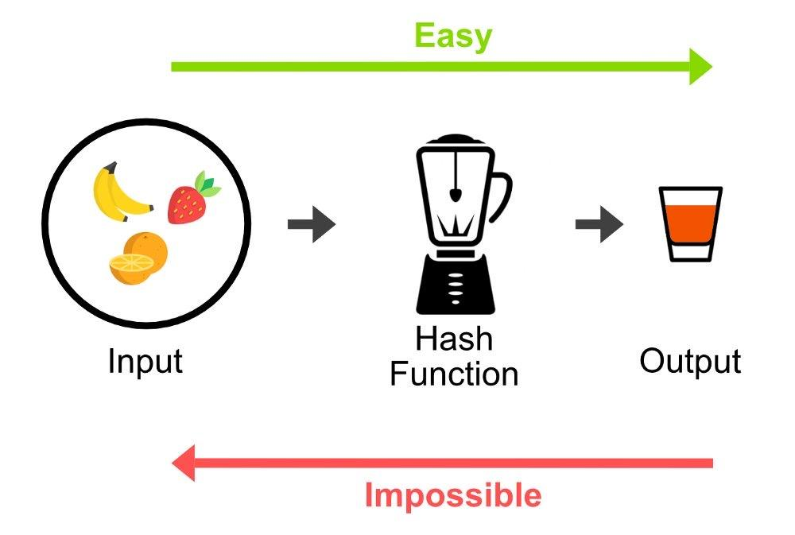

#### Hashing

**Hash-ul** este o funcție [one-way](https://en.wikipedia.org/wiki/One-way_function).
Ea primește un input oricât de mare (1 byte, un cuvânt, un fișier, un întreg HDD, etc) și returnează un string de o dimensiune fixă în funcție de tipul de hash folosit.
Hash-urile sunt rezistente la **coliziuni**, adică este extrem de greu de găsit 2 input-uri care să producă același hash.
Mai mult, un singur bit schimbat în input va genera un output complet diferit.
Exemple de algoritmi de hashing: md5 (învechit), SHA-1, SHA-256.

Hash-urile sunt folosite pentru verificarea integrității unui fișier (dacă chiar și un bit diferă, atunci va avea alt hash) și la stocarea parolelor.

Folosind comanda **md5sum** fără niciun parametru putem să generăm hash-ul unui text.

``` bash
student@uso:~$ echo -n "plaintext content" | md5sum
f88d6c9eab9c6a2ef3cfd3c59832b4d6  -
```

<figure>

</figure>
