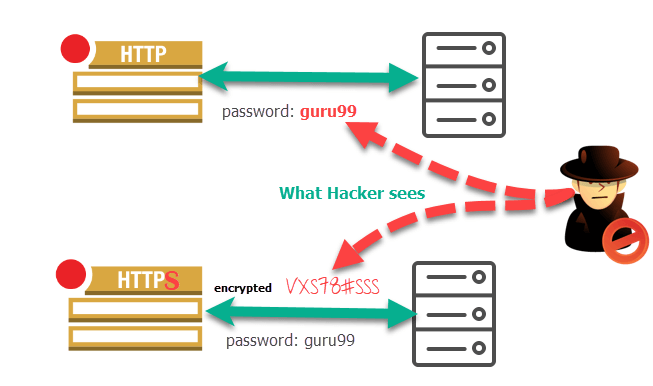

### HTTP vs HTTPS

Protocolul de rețea **HTTP** aduce beneficii din multe puncte de vedere.
Unul dintre dezavantajele lui este faptul că toate datele sunt trimise în clar.
Astfel, un atacator precum Trudy va putea intercepta și înțelege un pachet HTTP.

Acest start suplimentar necesar de criptare este adus de **HTTPS**, detaliat mai pe larg [aici](https://ro.wikipedia.org/wiki/HTTPS).

<figure>

</figure>
