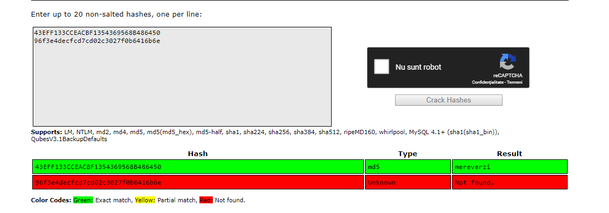
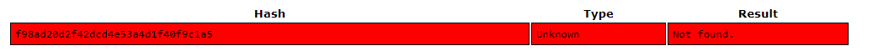

### Stocarea parolelor

1. Cea mai naivă abordare de stocare a parolelor într-o bază de date este în clar.
Dacă un atacator reușește să obțină acces la baza de date respectivă, nu doar că obține acces la toate conturile, ci și la orice alt cont al unui utilizator de pe alt site unde a fost folosită aceeași parolă.
Este evident că această abordare nu este **sigură**.

| User   | Password          |
| ------ | ----------------- |
| Mihai  | mereverzi         |
| Radu   | usoemisto         |
| Andrei | usoemehmateemisto |

2. O altă variantă (mai sigură) ar fi să nu stocăm parolele în clar, ci să stocăm **hash-ul** parolei în baza de date.
Astfel, când un utilizator se loghează, facem hash-ul parolei introduse de el și îl comparăm cu cel din baza de date.

| User   | Password                         |
| ------ | -------------------------------- |
| Mihai  | 43eff133cceacbf1354369568b486450 |
| Radu   | 4491fea305731261a83f75672e25bb88 |
| Andrei | 96f3e4decfcd7cd02c3027f0b6416b6e |

Abordarea este într-adevăr mai bună, dar încă nu complet sigură.
Deși hash-urile nu pot fi sparte direct (dintr-un hash să obținem mesajul inițial), ele pot fi atacate folosind dicționare.
Un dicționar este o mulțime de corespondențe `(hash_mesaj) → (mesaj)`.
Pentru a sparge un hash, putem folosi dicționare mari online precum [acesta](https://crackstation.net/).
Dacă avem norocul ca hash-ul să se afle în dicționar, atunci obținem parola în clar.
De obicei, acest lucru se întâmplă pentru toate parolele ce folosesc cuvinte cunoscute sau au o dimensiune/complexitate mică.

<figure>

</figure>

Pentru baza de date de mai sus, parola lui Mihai a putut fi spartă, dar cea a lui Andrei nu.
Andrei a avut o parolă mai lungă, dar acest lucru nu asigură neapărat siguranța ei.

3. O abordare finală ar fi să folosim un salt pentru hash-uirea parolei.
Salt-ul este un string random de câteva caractere random ce se folosește în felul următor la construirea unui hash: Hash(salt | parolă), unde “|” înseamnă concatenare.
Astfel, salt-ul previne atacul cu dicționar de mai sus deoarece este foarte puțin probabil ca hash-ul respectiv să existe într-un dicționar.
Salt-ul se stochează în clar în baza de date.

|       | Salt      | Password                         |
| ----- | --------- | -------------------------------- |
| Mihai | dfd454ddf | f98ad20d2f42dcd4e53a4d1f40f9c1a5 |

Pentru Mihai, este: Hash(dfd454ddfmereverzi).

<figure>

</figure>
